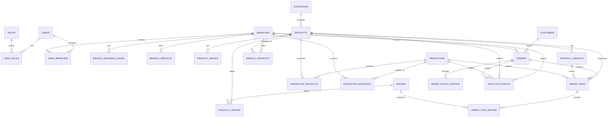

# ERD lógico — Brasa Viva

## Relaciones críticas

### Producto ↔ sucursal

Es N:M mediante `branch_products`.

`products.base_price` representa el precio general y `branch_products.price_override` permite sobrescribirlo por sucursal.

### Promoción ↔ sucursal

Es N:M mediante `promotion_branches`.

### Promoción ↔ producto

Es N:M mediante `promotion_products`.

### Usuario ↔ rol

Es N:M mediante `user_roles`.

### Usuario ↔ sucursal

Es N:M mediante `user_branches`, lo que permite que un gerente u operador trabaje con una o más sucursales.

### Pedido

Un pedido pertenece a una sola sucursal y contiene uno o más `order_items`.

Los ítems guardan snapshots de nombre y precio. Esta decisión es deliberada: un cambio futuro del catálogo nunca debe alterar el contenido histórico de un pedido.
